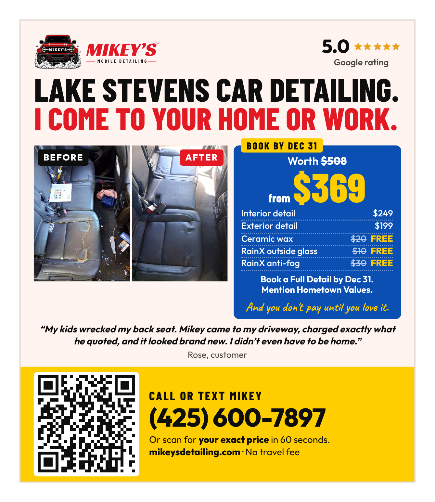

# Hometown Values magazine ad

A quarter-page ad for **Hometown Values Savings Magazine**, the coupon
magazine Jim Lee mails from Marysville (206-261-0752,
jim@myhometownvalues.com). Built 2026-10-12.



## History: the 2024 ad

Mikey ran one quarter page with Jim in fall 2024: the **Monroe/Sky Valley**
edition, 15,000 homes, **$460** (invoice 6262FAB dated Sep 17, paid Sep 26,
2024), mailed **Oct 1 to 3, 2024**. He skipped the holiday issue Jim offered
next ($435 for 15,000 homes in Snohomish, $505 for 20,000 in Lake Stevens). That ad
had:

- **360-799-9312**, an old number, and that phone was down for a stretch
  around when the magazine landed (his email of Dec 5, 2024: "My phone just
  came back online")
- "MOBLIE AUTO DETAILING" in the headline
- "Low Prices", "Full detail from $99", "$20 off": a bargain pitch
- no photo of his work, no reviews, no towns, no website or QR

So whatever it pulled says little about the magazine. This ad is the fair
test.

## Files

| File | What it is |
|---|---|
| `print-files/ad.pdf` | The ad, 4.0625" x 4.75", vector type. Send this one |
| `print-files/ad-300dpi.jpg` | The same at 300 dpi, if Jim's designer wants an image |
| `print-files/ad-offer.pdf` | **The one to send for the holiday issue**: the same ad with the Rain-Ready coupon. Only until Dec 31, 2026 |
| `print-files/ad-offer-300dpi.jpg` | The same at 300 dpi |
| `preview.png`, `preview-offer.png` | For looking at |
| `preview-SAMPLE-offer-not-approved.png` | An older sample coupon ($40 off). **Not an offer Mikey made** |

**Size:** measured off the frame on the 2024 proof (4.06" x 4.75"). No
bleed, because a quarter page sits in a box on a shared page. **Jim confirms
the spec before art goes in**: change `W` and `H` in the generator if his
differs, then re-run.

The QR goes to `mikeysdetailing.com/?utm_source=hometownvalues&utm_medium=mail#booking`,
so magazine visits show up in Google Analytics as **hometownvalues / mail**.
It's 1 inch at error-correction level L because that's what passes the
generator's blurry-phone check at this size. Ask Jim not to shrink it.

## What's on it, and why

The design is **#5, "big price first"**, picked 2026-10-19 out of five
layouts of Mikey's own Canva edit (cream, yellow call band) with a blue offer
box. Earlier rounds (`variations/`, `concepts/`, `premium/`) are kept for
reference; none of them is the ad.

- **Cream, a yellow call band, and one blue box.** Mikey's Canva edit
  (2026-10-19) moved the ad from white with a black band to cream with a
  yellow band. Blue is used once, on the offer, so it's the thing that pops on
  a page of white coupon ads.
- **The headline fills the width.** LAKE STEVENS CAR DETAILING. / I COME TO
  YOUR HOME OR WORK., each line stretched edge to edge (the generator sizes
  it). Mikey wanted it to pop more.
- **The back-seat before/after, shown whole.** Picked 2026-10-12 out of every
  photo in `social/photos/` and `images/`: crushed snacks, juice and stained
  leather are what every parent recognizes, and it's the website's lead photo.
  The photos are portrait, so they sit whole beside the offer: cropping them to
  a strip cut off the mess, and Mikey called that out.
- **The blue receipt is the price block** (`ad-offer.pdf`). Worth ~~$508~~,
  **from $369** in big yellow, then the lines that add up to $508: Interior
  $249, Exterior $199, ceramic wax ~~$20~~, RainX ~~$10~~, anti-fog ~~$30~~,
  all FREE. That's the homepage's own value stack, so the $508 is the
  receipt's arithmetic, not a claim; it needs no fine print. "Book a Full
  Detail by Dec 31. Mention Hometown Values." and the guarantee close it.
  Mikey worried that showing a price would cost calls (2026-10-19); it stays
  because a coupon magazine is read by people comparing prices, the QR and the
  phone give the price anyway, and "from $369" screens out the $99 crowd the
  2024 ad drew. `ad.pdf`, for any issue after Dec 31, is the same box as a
  plain price list (Full Detail from $369, Interior $249, Exterior $199).
- **5.0 and five stars, "Google rating", no count** (Mikey, 2026-10-19).
- **Rose's words, not a Google review.** "My kids wrecked my back seat. Mikey
  came to my driveway, charged exactly what he quoted, and it looked brand
  new. I didn't even have to be home." She said it to Mikey and said yes when
  he asked to use it (2026-10-19). It isn't one of the 40 on Google, so it's
  signed "Rose, customer", never "Google review", with no stars she didn't
  give. Check it word for word against her message before the art goes in,
  and keep a screenshot of it and her yes. The old quote, "Matt K. · Google
  review", is gone: none of the 40 Google reviews says it.
- **No spigot-and-outlet line** (Mikey, 2026-10-19: it doesn't need to be on
  the ad). Every other print piece carries it; for this one, say it on the
  phone when they book. "No travel fee" stays, in the yellow band.
- **The yellow band is the call to action**: the 1 in QR, "Call or text
  Mikey", the phone big, "your exact price in 60 seconds", the site.
- **Lake Stevens only** (Mikey, 2026-10-12: "make it like I'm local right in
  Lake Stevens"). The town leads the headline. He's based in Snohomish, so
  never that he lives or is based there. A different edition means changing
  `TOWN` in the generator.
- **The Rain-Ready offer** is the hangers' and postcards' (Mikey, 2026-10-14,
  for the holiday issue): same extras, same Dec 31, 2026 booking date, not a
  new offer. `OFFER=rainready npm run htv` builds it, and refuses to from
  January 1, 2027. Coupon magazines are read for coupons (Jim's CTM example
  led with "$50 OFF").

## The schedule

Every edition mails four times a year, in one of two cycles six weeks apart.
Jim's 2024 schedule (expect 2027 to land within a few days of it):

| Cycle | Editions (homes) | Spring | Summer | Fall | Winter |
|---|---|---|---|---|---|
| **A** | Lake Stevens (20,000), Snohomish (15,000), Mill Creek/Silver Lake (15,000), Marysville/Tulalip (30,000), plus Skagit, Pasco, Richland, Kennewick, Yakima | Feb 27 to 29, art 2/2 | May 21 to 23, art 4/26 | Aug 13 to 15, art 7/19 | Nov 19 to 21, art 10/25 |
| **B** | Monroe/Sky Valley (15,000), North Snohomish County (30,000: Smokey Point, Arlington, Lakewood, Stanwood, Camano), Bothell/Kenmore (15,000) | Apr 9 to 11, art 3/15 | Jul 1 to 3, art 6/7 | Oct 1 to 3, art 9/6 | Jan 16 to 18, art 12/27 |

Some editions cover towns he doesn't serve: Sky Valley (Sultan, Gold Bar,
Index), Stanwood and Camano, Kenmore. Those homes are paid for and can't book.

## The plan

**Lake Stevens, holiday issue (Winter A 2026): mails Nov 17 to 19, art due
Fri Oct 23**, quarter page, `ad-offer.pdf` (Mikey, 2026-10-14: send it now
rather than wait for spring). One issue, no contract, until it shows bookings.

**Jim's 2026 rates** (his email of 2026-10-13 and rate cards): a quarter page
is **$625 one time / $525 each at 4x** in Lake Stevens (20,000 homes) and
$555 / $455 in Snohomish (15,000). His email quoted the 4x prices, so ask
whether $525 holds for one issue. Half is due when the space is reserved,
the rest on proof approval. Custom design is $75 (not needed), web and app
listing $40.

- **Lake Stevens** over Snohomish: 5,000 more homes for $70 more (3.1 cents
  a home against 3.7), about 78% owner-occupied and 2.9 people a household,
  and the ad is already written for it. Both at once is $1,180, and one zone
  tells as much as two on a first test.
- **Quarter page** over the others: a half page costs 56% more ($975) for
  about 8% more recall in the print studies (Newsworks: quarter 52%, half
  56%, full 66%); a 1/6 ($525) can't hold the photo, prices, coupon and a
  1 in QR.
- **The catch:** from Nov 1 a weekday 1:00 PM Full Detail doesn't finish
  before dark, so Full Details from this ad mostly land on the 7:00 AM
  Saturday slot until the work lights are ready. Rain-Ready jobs booked by
  Dec 31 can be done through Jan 31. Interiors and exteriors still fit
  weekdays.
- **What it might return** (estimates, nobody publishes a shared-mail rate
  for a $369 service): 2 jobs weak (1.2x), about 5 realistic (about 3x), 10
  strong (about 6x). Break-even is 2 Full Details at $625.
- **Next, if it pays:** the same edition again in Spring A 2027 (2026's
  spring issue mailed Feb 24 to 26, art 1/30), without the coupon after Dec
  31, or Monroe/Sky Valley in Cycle B for a rematch with the 2024 edition.

**Count it:** "how'd you hear about me?" on every booking, plus
**hometownvalues / mail** in Google Analytics.

**Before sending the art:**

1. Jim's spec (size, bleed, PDF or JPG, CMYK).
2. Rose's quote, word for word against her message (and a screenshot of her
   yes). The rating on Google still 5.0.
3. The prices against `PRICING.md`.
4. Ask Jim to take down anything of Mikey's old ad in the Hometown Values app
   or website (the 360 number, $99).

## Editing in Canva

`CANVA=1 npm run htv` writes `canva/ad.html` plus its images (the two
full-size back-seat photos, the QR and the logo). Canva's import tool turns
that page into a design where every word is a live text box. A PDF import
doesn't work: it drops the photos and doubles letter-spaced text (the shared
postcard found that out).

- **The Canva version is in Poppins, not Outfit.** Canva has no Outfit and a
  free plan can't upload fonts. The headline (Barlow Condensed) and the
  handwriting (Caveat) are the same.
- **Nothing in Canva checks the facts**, the safe margin, the QR size or the
  6.5 pt floor; this generator does. Keep text 0.14 in from the edges and the
  QR at 1 inch. A price or review count changed in Canva is one more copy of
  the facts table that the repo can't see.
- **To print from Canva:** Share, Download, PDF Print, and send Jim that.
- **To rebuild it** after a copy change here: `CANVA=1 npm run htv`, merge,
  then import `https://raw.githack.com/mikeygabmiller/mikeysite/<commit>/print/hometown-values/canva/ad.html`
  with Canva's import tool (raw.githack serves it as a web page, which Canva
  needs).

## Changing it

Copy lives in `print/tools/build-htv-ad.cjs`. Never edit the PDF.

```sh
cd print/tools
npm install
npm run htv
```

It fails if anything leaves the safe area, type drops under 6.5 pt, blocks
touch, the QR stops decoding (sharp, and at 95 dpi blurred), or the copy
picks up an em dash, "insured" or "licensed", a business "we", a work day,
Lynnwood, Edmonds or Kenmore, Rain-Ready or $508 on the version without the
offer, an old phone number, a quote time other than 60 seconds, or any served
town but Lake Stevens, or loses a price, "no travel fee", the Lake Stevens
headline, or (on the offer version) $508, Dec 31 and "Mention Hometown
Values". Every fact on the ad is one more copy of the table in the repo's
`CLAUDE.md`.
