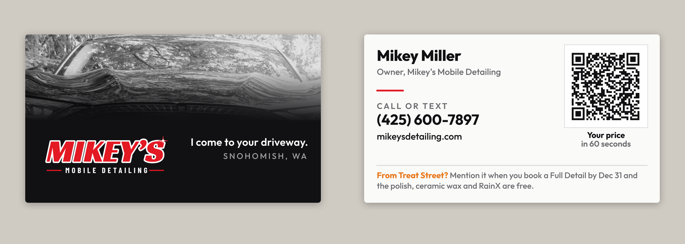

# Treat Street business card

A plain 3.5 x 2 in card for **Treat Street, Saturday October 24, 2026, 4 to 7
PM, Evergreen Speedway in Monroe** (under the grandstands, 1,300+ tickets).
Printed at the UPS Store in Snohomish. Not served (`_config.yml` excludes
`print/`).

## The brief (Mikey, 2026-10-15)

Clean and professional, not a rehash of the other cards, with **one** hint
that it came from Treat Street. Two earlier tries were turned down: a busy
Halloween card, then three concepts (full Halloween, plain white, a coloring
card).

## How it's built, and why

What the printer and designer guides agree on (sources in
`print/business-card/RESEARCH.md` and below): the logo is the biggest thing on
the card, one way to reach you, at least about 30% empty space, one or two
colours, type no smaller than 7 to 8 pt, and a back that does one job. For a
card handed to strangers, that job is getting them back to you.

- **Front: his own work.** A black hood he detailed, reflecting the trees,
  in black and white across the top, fading into black. Under it the
  MIKEY'S wordmark (the only colour on the front) and "I come to your
  driveway. / Snohomish, WA". No phone on the front: the guides say don't
  repeat the front on the back, and the back is where the contact block
  lives. The photo is from his shared album (`social/photos/mach-e-black.jpg`,
  cleared for posting) cropped to the hood: no plate, no badge, no faces.
- **Back: who, how, and the QR.** Mikey Miller / Owner, a short red rule,
  "Call or text" and the number, the website, and a QR to the quote
  calculator ("Your price in 60 seconds").
- **The one Treat Street touch:** the orange line along the bottom of the
  back. "From Treat Street? Mention it when you book a Full Detail by Dec 31
  and the polish, ceramic wax and RainX are free." That's the Rain-Ready
  offer on the hangers' terms, not a new one. The generator refuses to build
  from January 1, 2027.
- **The QR** goes to
  `https://mikeysdetailing.com/?utm_source=treatstreet&utm_medium=event#booking`,
  so Google Analytics shows these as **treatstreet / event**.

The generator fails on an em dash, a business "we", licensed/insured, a town
he doesn't serve, a quote time other than 60 seconds, type under 7 pt, type
within 0.125 in of the trim, overlapping text, or a QR that stops decoding.

## Printing it

`print-files/front.pdf` and `print-files/back.pdf`, 3.75 x 2.25 in each:
3.5 x 2 trim plus 0.125 in bleed. Tell the printer: "3.5 x 2 trim, bleed is
already in the file, print at 100%, don't resize." Full colour both sides,
16 pt stock, **matte** if they have it (the photo and black read richer, and
gloss shows fingerprints on a black card).

Before they run the rest, check one card: scan the QR, and look at the photo
band. It should read as gloss and reflections, not as a grey smudge. If it
prints too dark, ask them to lighten it a little rather than changing the file.

Rebuild with `cd print/tools && npm install && npm run treat`.

## Sources

- [Paperlust, cards that get kept (printer guide, 2026)](https://printshop.paperlust.co/blog/?p=357)
- [4OVER4, layout principles (printer guide)](https://www.4over4.com/guide/graphic-design-layout-principles-a-practical-guide)
- [Mobilo, professional card design (2026)](https://www.mobilocard.com/post/professional-business-card-design-ideas)
